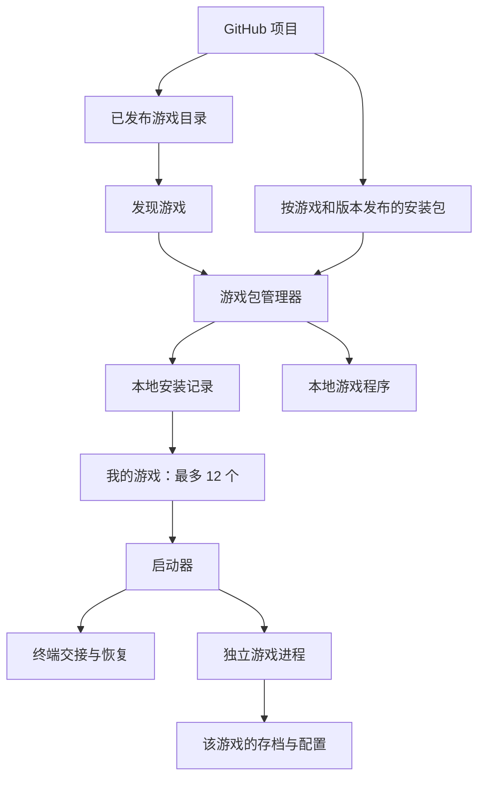

<spec-entry category="arch" keywords="standalone-game,tui-launcher,github-catalog,package-manager" date="2026-09-24" source="docs/README.md:24">

# 架构设计

| 项目 | 内容 |
| --- | --- |
| 版本 / 状态 | 0.7 / 设计草案，产品决策已收录，工程默认方案待实现验证；M1 已实现 |
| 需求来源 | U-01 至 U-15，见[设计来源](README.md#设计来源) |
| 目标 | 轻量游戏平台、独立游戏进程、GitHub 分发、本地最多安装 12 个游戏 |

## 1. 产品边界

### 1.1 已确认方向

1. 平台面向社区共创，游戏具备独立运行能力。
2. 游戏的核心玩法必须能够在终端交互界面中完成。
3. 平台连接 GitHub 获取本项目的游戏目录，供用户选择安装。
4. 每个本地游戏库最多安装 12 个游戏，支持卸载、重装和替换。
5. 是否提供存档由游戏决定；需要持久化时各游戏数据相互独立，二创和第三方引用需要说明。
6. 首版支持 Windows x86_64、Linux x86_64、macOS x86_64 / arm64，用户通过终端命令打开大厅。
7. 游戏是否联网由自身设计决定，平台不把离线能力作为收录门槛。
8. 游戏采用预构建可运行包分发，玩家无需安装语言运行环境或在本机编译游戏源码。
9. 平台自身提供一条安装命令，自动下载并配置启动入口，同时保留手动下载安装方式。
10. 当前阶段只做本地开发与验证，GitHub 仓库配置和发布暂缓。
11. 平台原创代码采用 MIT；游戏与第三方材料分别遵守其适用许可证。

### 1.2 默认方案

- 游戏以独立进程运行，可独立选择语言和 TUI 技术。
- 首版使用单仓库组织贡献，使用每个游戏独立的版本安装包分发。
- 平台提供“我的游戏”和“发现游戏”两个主要界面。
- GitHub 作为目录和安装包来源，不作为运行游戏的必需在线服务。
- 平台提供强制遵循的专属数据目录约定，不理解游戏存档内容。
- 首版只接受官方目录中的、经过审核的游戏包。
- 平台渲染后端须覆盖三类目标系统；是否保留 Python / curses 并补适配层，不限制游戏技术栈。（0.7）该选择记为待决事项 Q-09，应在进入 M2 前确定，而不是等到跨系统验证之后：M2 的包管理、下载、解包和加锁是平台代码量最大的部分，写完再换语言代价高；当前大厅只有约 300 行，替换成本低。

（0.7）平台技术栈对比：

| 方案 | 分发 | Windows | 终端能力 | 评审意见 |
| --- | --- | --- | --- | --- |
| Python + curses（现状） | 平台自身也要用 PyInstaller 等方式分系统打包 | 标准库无 curses，需第三方 `windows-curses` | 无 24 位真彩色与 Kitty 键盘协议 | 不建议作为最终方案 |
| Go + bubbletea | 单机交叉编译 4 个目标的单文件程序；链接器为 darwin/arm64 自动 ad-hoc 签名 | 原生 | 真彩色 | 推荐；标准库覆盖 HTTP、zip、tar、SHA-256 |
| Rust + ratatui / crossterm | 单文件程序；交叉编译需多构建机或 cross 工具 | 原生 | 真彩色、Kitty 键盘协议 | 备选；与 Grok Build 同栈，渲染上限最高，学习成本最高 |

交叉编译能力影响 `macos-x86_64` 目标：托管 CI 的 Intel Mac 构建机正在逐步减少，需要逐系统原生构建的方案应提前确认构建来源。平台选型不影响游戏，坦克大战可继续使用 Python。

### 1.3 首版不包含

第三方插件市场、任意仓库 URL 安装、多人联网基础设施、全局排行榜、云存档、自动解析任意构建脚本、跨语言游戏 SDK、游戏进程安全沙箱。

平台自身安装体验已通过 Q-04 确定，见 1.5；其升级策略仍待决，不与“在大厅中安装游戏”混为同一个流程。

### 1.4 系统支持与终端入口

统一终端命令只统一启动体验，不会自动消除系统差异。平台需要分别实现或验证终端输入输出、进程中断、退出恢复、数据路径和安装包启动行为。

Windows 不能只以 WSL 中可运行代替原生支持目标。首版安装包矩阵已确定：

| 系统 | CPU 架构 | 目标标识 |
| --- | --- | --- |
| Windows | x86_64 | `windows-x86_64` |
| Linux | x86_64 | `linux-x86_64` |
| macOS（Intel） | x86_64 | `macos-x86_64` |
| macOS（Apple Silicon） | arm64 | `macos-arm64` |

最低系统版本、Linux 系统库基线和终端测试矩阵需要在构建验证后确定。Windows / Linux ARM64 暂不属于首版正式支持目标；不因“支持三类系统”而默认承诺所有历史版本和硬件。

游戏仍须声明自身实际支持的系统与架构；平台提供对应筛选，不虚构游戏兼容性。Q-03 已确定采用预构建包，平台根据系统、架构和运行条件自动选择对应资产；不存在兼容包时明确提示，不能静默退回源码安装。

当前代码的 Python / curses 实现不代表三系统目标已经完成。Python 官方文档指出 Windows Python 不内置 curses，需要额外适配或选择其他后端，见 [curses 文档](https://docs.python.org/3/howto/curses.html)。

### 1.5 平台自身的安装入口

已确认的玩家体验为：复制对应系统的一条安装命令 → 自动下载平台 → 配置终端启动入口 → 使用启动命令进入大厅。另行提供按系统选择的手动下载安装包。

“一条命令”指每个系统的一步安装入口，不要求 PowerShell 与 Unix Shell 使用同一条文本。最终启动命令名称、下载地址和平台升级方式仍待确定，本文不提供尚不存在的可执行安装命令。

默认实现要求：安装器识别系统与架构，校验下载资产，准备平台所需运行环境，将入口配置到用户可用的命令路径。优先安装到用户目录，不覆盖无关同名命令；重复安装应可识别现有版本。涉及 PATH 的配置应可追溯，若需要新开终端生效，安装结果必须明确提示。

安装器为平台维护者发布的受控组件，不意味着允许游戏包携带任意安装脚本。手动安装说明应包含包选择、文件位置和命令路径配置步骤，两种方式最终进入同一个大厅。

平台安装验收至少覆盖：各支持系统上首次安装后可用命令打开大厅；重复安装不会破坏游戏与存档；下载失败保留既有平台；手动安装得到相同启动能力。具体升级及卸载平台的实现另行设计。

### 1.6 本地阶段与未来发布

当前先以本地目录文件和本地预构建包验证发现、安装、替换、重装和卸载流程。建议把来源读取封装为统一接口，先实现本地来源，后续添加 GitHub 来源；包管理器和安装记录不依赖 GitHub 的专有返回结构。

本地模式必须明确显示来源为本地，不显示虚构的联网刷新时间。暂缓远端配置不改变公开发行时采用 GitHub 目录的产品方向，也不授权当前创建远程仓库或发布文件。

## 2. 总体结构



## 3. 模块职责

| 模块 | 职责 | 不承担的职责 |
| --- | --- | --- |
| `lobby` / `game_library` | 已安装游戏、详情、操作入口、安装任务展示 | 游戏规则、游戏输入解析 |
| `catalog_client` | 通过来源接口读取目录；当前本地，未来 GitHub；展示来源、缓存和更新时间 | 安装时执行游戏代码 |
| `manifest` | 校验目录与游戏清单、识别协议版本 | 解释游戏内部对象 |
| `package_resolver` | 为操作系统、CPU 架构和运行环境选择安装包 | 猜测不兼容包能否运行 |
| `download_manager` | 下载、进度、取消、超时、校验 | 激活安装、占用游戏名额 |
| `package_manager` | 安装、更新、重装、替换、卸载事务 | 游戏存档迁移 |
| `installation_registry` | 安装版本、路径、活动指针、名额和事务记录 | 从 UI 状态推断真实安装状态 |
| `operation_queue` | 批量任务、名额预留、修改互斥和恢复调度 | 游戏主循环 |
| `preflight` | 启动文件、运行条件、终端尺寸检查 | 未经用户操作安装依赖 |
| `runner` | 游戏进程的创建、等待、退出和中断 | 根据退出码判断游戏胜负 |
| `terminal` | 暂停大厅、终端所有权交接、最终恢复 | 统一所有游戏的画布实现 |
| `services` | 专属数据目录、日志目录；备份导出策略暂缓 | 强制游戏存档、解释和修改存档字段 |
| 独立游戏 | 规则、关卡、输入、渲染、主循环；按需配置和存档 | 读写其他游戏数据或平台安装记录 |
| `arcade_kit`（可选，0.7） | Python 游戏可复用的绘制、配色降级、帧提交和各系统目录规则；游戏构建时随包打入 | 由平台在运行时提供，或成为接入的必要条件 |

## 4. 依赖与执行边界

平台 UI 通过目录、包管理器和启动器提供的接口工作，不自行删除目录或修改安装记录。游戏只依赖自己的代码、运行环境以及公开接入约定，不导入平台内部模块，也不导入另一个游戏的源码。（0.7）共用工具包 `arcade_kit` 是游戏自选的库而非平台接口：平台不修改游戏的 `PYTHONPATH`，源码布局下游戏自行从仓库 `kit/` 找到它，安装包须把它一并打入。

目录读取和详情浏览只处理数据，不导入游戏模块。运行中的游戏由其进程独占交互终端，平台停止读取该终端输入与绘制大厅。

独立进程改善生命周期隔离，但不提供文件系统或网络安全隔离。官方游戏审核仍有必要；日志和数据目录的划分不能被描述为安全沙箱。

首版安装修改使用全局操作锁并串行提交。下载可以并发，UI 不应因为下载和解压而冻结。运行中的游戏不得被更新、重装、卸载或作为替换目标；任务可以排队等待其退出。

## 5. 建议仓库结构

以下为目标目录草图，不是当前目录结构，也不要求在一个 PR 中一次性移动完成。

```text
tui-arcade/
├── platform/
│   ├── pyproject.toml
│   └── src/tui_arcade/
│       ├── lobby/
│       ├── catalog/
│       ├── manifest/
│       ├── packages/
│       ├── runner/
│       ├── terminal/
│       └── services/
├── catalog/
│   └── games.json
├── games/
│   └── tank/
│       ├── game.json
│       ├── README.md
│       ├── LICENSE
│       ├── CREDITS.md
│       ├── src/
│       ├── levels/
│       └── tests/
├── schemas/
├── templates/minimal-game/
├── tests/integration/
├── docs/
└── CONTRIBUTING.md
```

源码目录与分发包不是同一概念。Python 游戏可以有自己的 `pyproject.toml`，其他语言采用各自构建清单；安装包必须遵守统一接入约定。

## 6. 用户数据布局

```text
<程序根目录>/games/<game_id>/<安装实例>/
<用户数据目录>/tui-arcade/installed.json
<用户数据目录>/tui-arcade/transactions/
<用户数据目录>/tui-arcade/games/<game_id>/
<用户缓存目录>/tui-arcade/catalog/
<用户缓存目录>/tui-arcade/downloads/
<用户日志目录>/tui-arcade/<game_id>/
```

“安装实例”由版本和独立标识组成，保证重装同一版本时也能先写入新位置。安装记录指向活动实例；备份、缓存和未激活实例不额外占游戏名额。

实际系统路径须分别为 Windows、macOS、Linux 定义；不把开发者机器路径写入包或清单。CPU 范围按 1.4 的 4 种组合执行，最低系统版本待验证。最终激活前的暂存区应与程序目录处于同一文件系统，不能假设跨文件系统移动具有原子性。

（0.7）各系统路径，已在 `kit/arcade_kit/paths.py` 实现并由平台与游戏共用：

| | Linux | macOS | Windows |
| --- | --- | --- | --- |
| 程序根目录 | `$XDG_DATA_HOME/tui-arcade/programs` | `~/Library/Application Support/TUI Arcade/programs` | `%LOCALAPPDATA%\Programs\tui-arcade` |
| 用户数据目录 | `$XDG_DATA_HOME/tui-arcade` | `~/Library/Application Support/TUI Arcade` | `%LOCALAPPDATA%\tui-arcade` |
| 游戏数据 | `<用户数据目录>/games/<id>` | 同左 | 同左 |
| 日志 | `$XDG_STATE_HOME/tui-arcade/logs/<id>` | `~/Library/Logs/TUI Arcade/<id>` | `%LOCALAPPDATA%\tui-arcade\logs\<id>` |
| 缓存 | `$XDG_CACHE_HOME/tui-arcade` | `~/Library/Caches/TUI Arcade` | `%LOCALAPPDATA%\tui-arcade\cache` |

- XDG 变量缺省时使用 `~/.local/share`、`~/.local/state`、`~/.cache`；macOS 上显式设置 XDG 变量时也以其为准。
- `TUI_ARCADE_HOME` 把以上全部改到一个目录的 `programs/`、`data/`、`logs/`、`cache/` 下，用于测试与便携安装。
- 暂存区放在程序根目录内，保证与活动实例同一文件系统。Windows 的程序与数据同在 `%LOCALAPPDATA%` 下。
- Windows 路径长度默认受 260 字符（MAX_PATH）限制：实例目录名应尽量短（如 `games/tank/0.2.0-a1b2/`），游戏包自带的语言运行环境往往嵌套很深，打包验证须覆盖该限制。

## 7. 演进计划

| 阶段 | 交付 | 完成条件 |
| --- | --- | --- |
| M0 文档基线 | 本组设计文档 | 已确认方向、默认方案、待决事项可区分 |
| M1 独立运行 | 拆出坦克入口、终端交接、最小游戏样例 | 两个独立入口可运行；平台可启动并恢复大厅。（0.7）已完成：macOS / Linux 上由真实终端测试覆盖；Windows 交接尚未实现 |
| M2 本地包管理 | 本地来源、选择安装界面、安装记录、名额和管理事务 | 本地预构建包可完成管理流程，最多 12 个；当前优先推进 |
| M3 GitHub 目录 | GitHub 来源适配、目录发布和安装包 | 后续确定官方地址与发布权限后启用；不阻塞本地验证 |
| M4 完整生命周期 | 更新、重装、替换、恢复和社区模板 | 通过安装管理验收矩阵，文档覆盖真实行为 |

已有坦克最高分需要在 M1 或 M2 明确迁移：读取旧 `scores.json` 的 `tank_best`，在目标数据不存在时导入，保留旧文件；重复运行不得覆盖更高的新纪录。（0.7）已在 `games/tank/tank_battle/storage.py` 实现：旧位置为 `$XDG_DATA_HOME/tui-arcade/scores.json`（缺省为 `~/.local/share`），新位置为该游戏数据目录下的 `scores.json`；无法读取的记录另存为 `scores.json.corrupt` 后再写入，不静默覆盖。

## 8. 架构验收

- 新增合规游戏不需要修改大厅中的游戏专属输入、绘制或规则代码。
- 游戏脱离平台仍能启动，在平台内启动时遵循数据目录和终端契约。
- 目录刷新失败不删除本地安装信息；本地库可独立于远端目录加载。
- 安装生命周期遵守[安装管理规范](game-management.md)，包括失败保留旧程序。
- 玩家数据不会因普通更新、重装、替换或卸载被删除。
- 文档要求的平台与游戏兼容性，有真实测试结果支撑。

</spec-entry>
